# Guida breve al Bilancio di competenze

Percorso per gli studenti IeFP di tutti gli anni, in circa tre ore e in sette sezioni. Le schermate qui sotto mostrano uno **studente di prova** (Marco Rossi, Informatica) con il percorso già compilato. Per provarlo da soli: «Salva e stampa», poi «Carica una copia» e scegliere [`guida/studente-di-prova.json`](guida/studente-di-prova.json). **Non premere «Invia al docente» con lo studente di prova**: la riga arriverebbe nel foglio vero.

**Come funziona in generale.** Le risposte si salvano da sole nel browser e ci si può tornare in ogni momento. Nessuna domanda è obbligatoria e si può sempre andare avanti. Non ci sono voti né punteggi.

## Home

Titolo, tre righe di spiegazione e le sette sezioni. Chi ha già iniziato trova «Riprendi da dove eri».

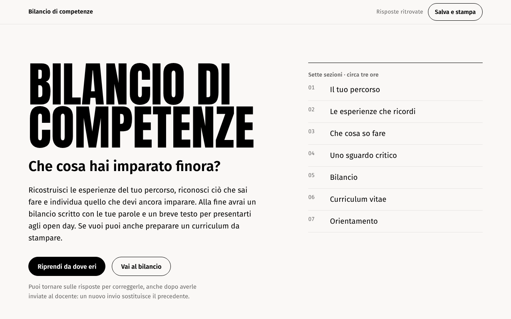

## 01 Il tuo percorso

Anno frequentato, indirizzo, nome e classe, poi alcune righe libere per far riaffiorare i ricordi: un campo per ogni anno già vissuto più uno per il tirocinio. Scegliendo l'anno il percorso si adatta: un primo anno vede solo il primo anno, un terzo anno i primi tre. Anche l'elenco dei periodi nelle esperienze segue l'anno.

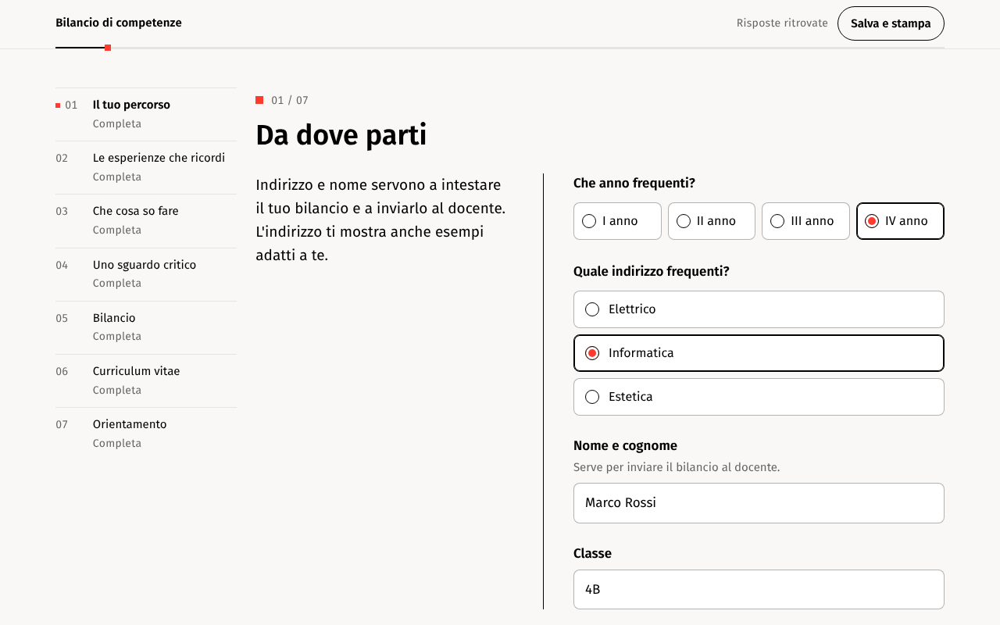

## 02 Le esperienze che ricordi

Una scheda per ogni esperienza: che cosa ho fatto, come posso dimostrarlo, che cosa è stato difficile e quale aiuto mi è servito. Contesto, autonomia e situazioni stanno sotto «Aggiungi dettagli». C'è un esempio da aprire, sempre indicato come esempio.

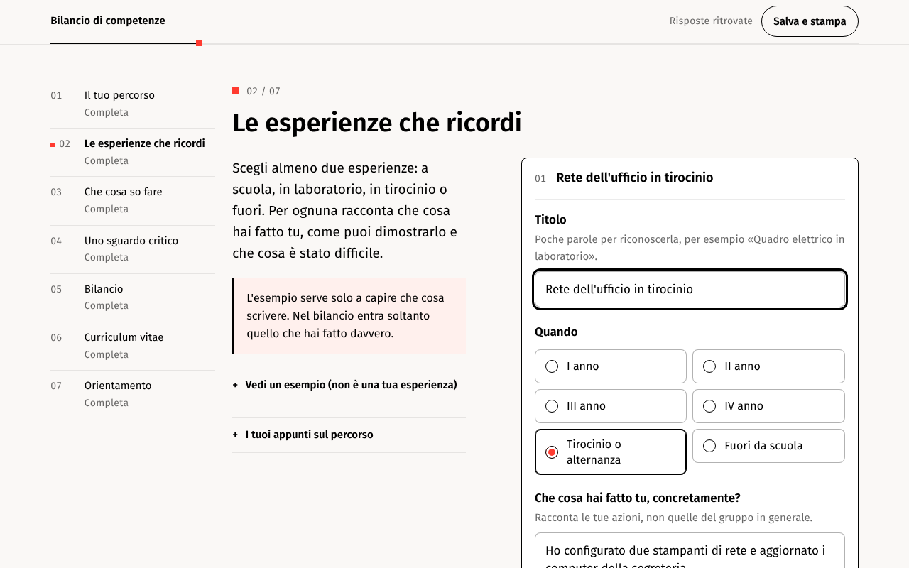

## 03 Che cosa so fare

Una schermata con sei situazioni comuni ai tre indirizzi: capire, fare, collaborare, verificare, spiegare, migliorare. Lo studente sceglie la frase più vicina alla verità e, se dice di saperlo fare, scrive un esempio. «Non l'ho mai affrontato» è distinto da «Non lo so ancora fare».

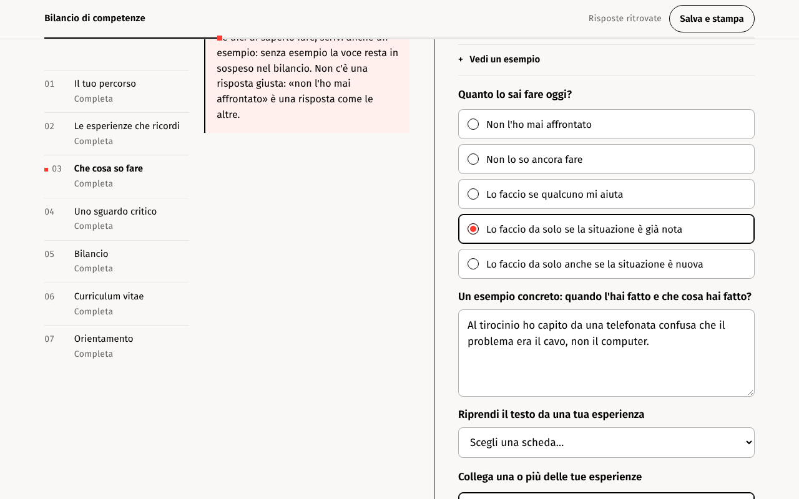

## 04 Uno sguardo critico

Tre domande aperte su scuola, tirocinio e su che cosa resta da imparare, con un esempio di risposta.

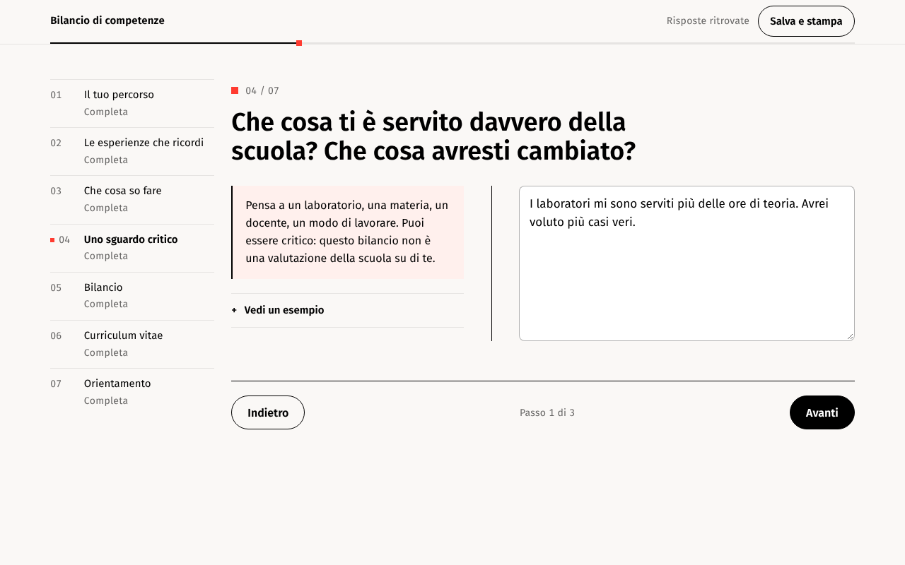

## 05 Bilancio

Il documento si compone da solo con le parole dello studente, senza riscriverle: So fare, Ho imparato così, Posso dimostrarlo, Devo ancora imparare. Da ogni voce si torna alla risposta per correggerla. Si può stampare o salvare in PDF, oppure inviare al docente.

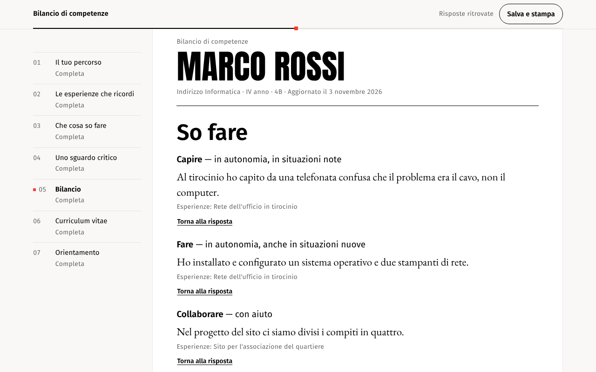

## 06 Curriculum vitae

Dati, profilo, formazione, esperienze di lavoro, competenze e lingue. Per le lingue si sceglie tra frasi semplici (da «Poche parole e frasi semplici» a «Come un madrelingua»), senza scrivere livelli. Si può scegliere tra tre modelli (Contemporaneo, Classico ed Europass), cambiare colore, carattere e dimensione e correggere il testo direttamente sul foglio. **Il curriculum resta sul dispositivo dello studente e non viene inviato al docente.**

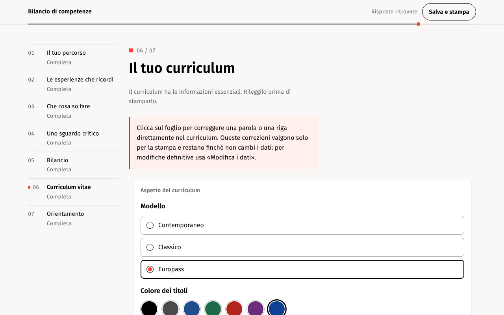

Il modello Europass, con tabella delle lingue e livelli europei compilati dalle scelte dello studente:

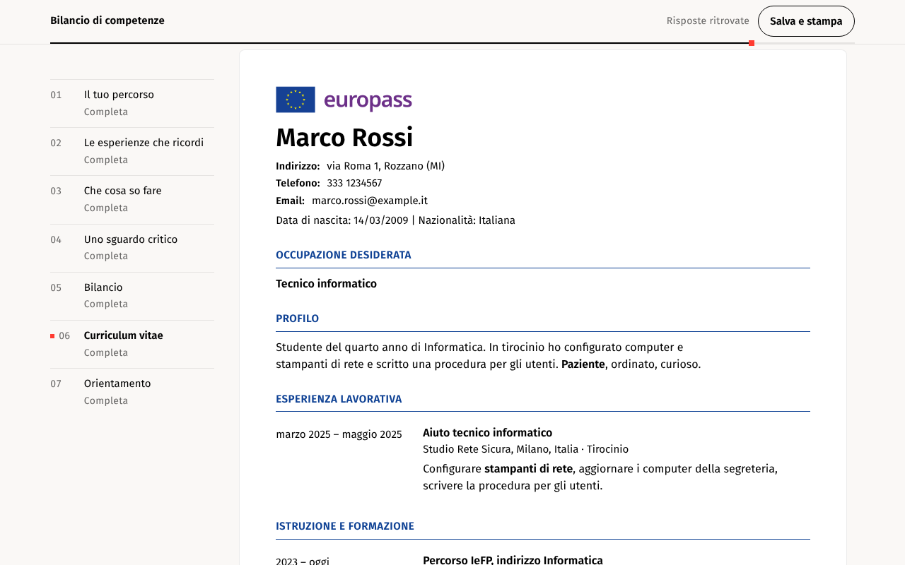

## 07 Orientamento

Quattro domande guida e una bozza che mette in fila le risposte, senza cambiarle, per presentarsi agli open day. Il testo si corregge a piacere.

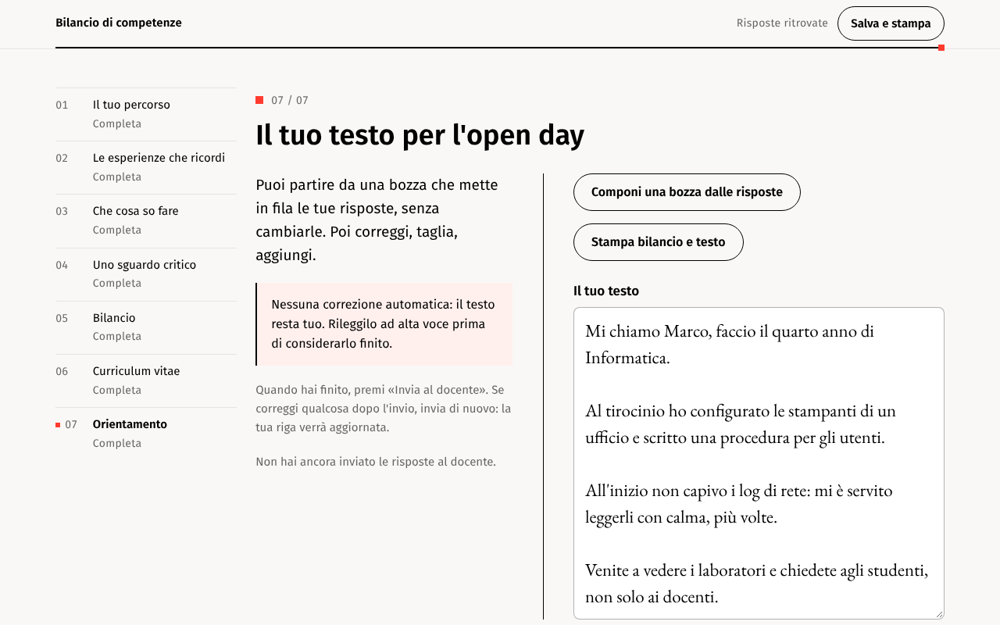

## Salva e stampa

Sempre raggiungibile in alto a destra: invia al docente, scarica una copia per riprendere su un altro dispositivo, stampa il bilancio o il curriculum, cancella le risposte dal browser.

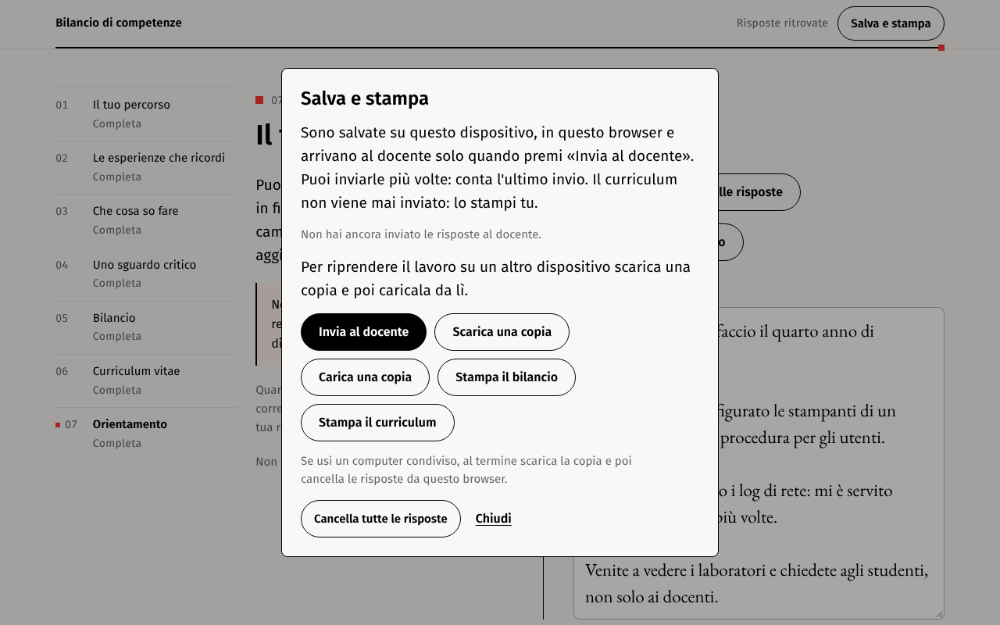

## Da telefono

Sullo smartphone l'indice diventa un pulsante e «Avanti» resta sempre visibile in basso.

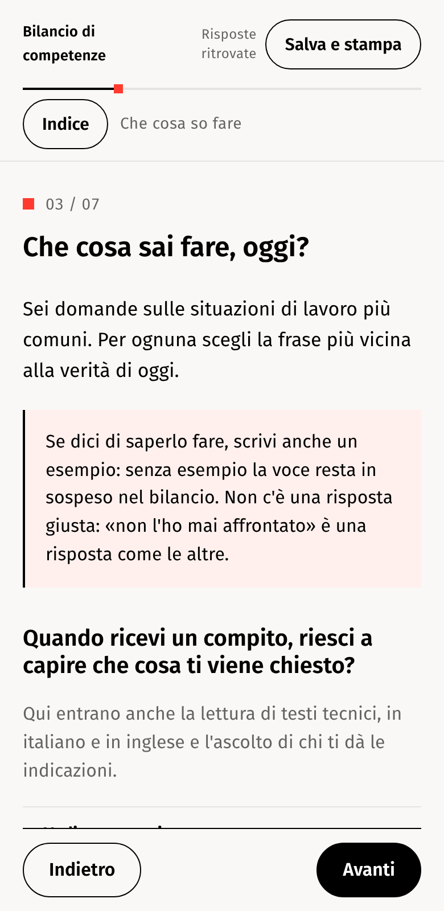

## Che cosa vede il docente

Solo se si preme «Invia al docente»: una riga nel Foglio Google con indirizzo, esperienze, livello e esempio di ogni situazione, sguardo critico e testo per l'open day. Istruzioni di configurazione in [FOGLIO-GOOGLE.md](FOGLIO-GOOGLE.md).
